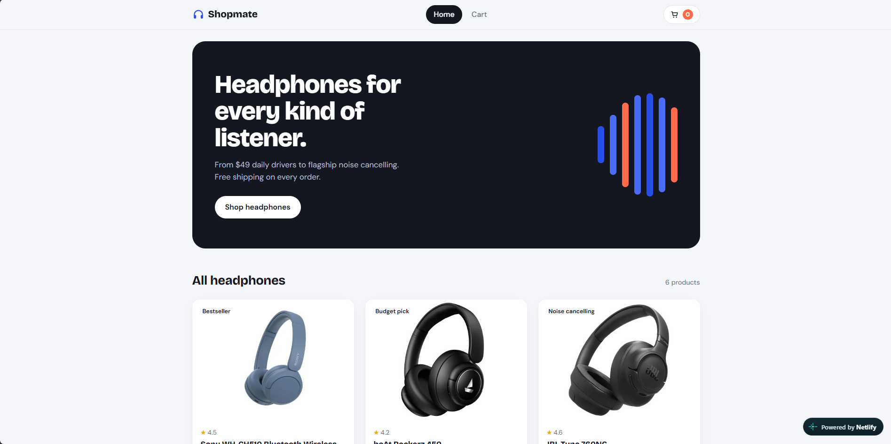

# 🎧 Shopmate

A responsive shopping website UI built with **React**, where you can browse headphones, add them to a cart, adjust quantities, and see your order total.

**🔗 Live demo:** [d-shopmate.netlify.app](https://d-shopmate.netlify.app/)
**📦 Repository:** [github.com/deepikayadav610/shopmate](https://github.com/deepikayadav610/shopmate)



> Built as the final project for the _React with AI_ course by Internshala Trainings.

---

## ✨ Features

- **Homepage** with a hero banner and a grid of all available products
- **Product cards** showing image, name, rating, tag and price
- **Add to cart** with instant feedback ("Added ✓") and a live cart count in the navbar
- **Cart page** where you can increase or decrease quantity, remove items, and see line totals
- **Order summary** with subtotal, shipping and total
- **Empty cart state** that guides you back to the shop
- **Loading skeletons** while products are fetched, and an error message if loading fails
- **Fully responsive** layout for desktop, tablet and mobile
- **Accessible** touches: visible keyboard focus, ARIA labels, and reduced-motion support

## 🛠️ Tech Stack

| Area             | Tools                                    |
| ---------------- | ---------------------------------------- |
| Framework        | React 18                                 |
| Build tool       | Vite                                     |
| Routing          | React Router DOM                         |
| State management | React Hooks + Context API                |
| Styling          | Plain CSS (CSS variables, Grid, Flexbox) |
| Deployment       | Netlify                                  |

## ⚛️ React Concepts Used

- **`useState`** manages cart items, loading state and button feedback
- **`useEffect`** fetches products from `products.json` and handles timers
- **`useContext`** with a custom `useCart` hook shares cart data across pages
- **React Router** handles navigation between the Home and Cart pages
- **Reusable components** include `Navbar`, `ProductList`, `ProductCard` and `CartItem`
- **Dedicated routes file** keeps route configuration separate from the app

## 📁 Project Structure

```
shopmate/
├── public/
│   ├── images/            # Product images
│   ├── products.json      # Product data (fetched with useEffect)
│   └── _redirects         # Netlify SPA routing fix
├── src/
│   ├── components/
│   │   ├── Navbar.jsx
│   │   ├── ProductCard.jsx
│   │   ├── ProductList.jsx
│   │   └── CartItem.jsx
│   ├── context/
│   │   └── CartContext.jsx
│   ├── pages/
│   │   ├── Home.jsx
│   │   └── Cart.jsx
│   ├── routes/
│   │   └── AppRoutes.jsx
│   ├── App.jsx
│   ├── main.jsx
│   └── index.css
├── index.html
└── package.json
```

## 🚀 Getting Started

**Prerequisites:** [Node.js](https://nodejs.org/) 18 or newer and npm.

```bash
# 1. Clone the repository
git clone https://github.com/deepikayadav610/shopmate.git

# 2. Move into the project
cd shopmate

# 3. Install dependencies
npm install

# 4. Start the dev server
npm run dev
```

Then open the local URL shown in your terminal (usually `http://localhost:5173`).

### Other scripts

| Command           | What it does                          |
| ----------------- | ------------------------------------- |
| `npm run dev`     | Starts the development server         |
| `npm run build`   | Creates a production build in `dist/` |
| `npm run preview` | Previews the production build locally |

## 🌐 Deployment

The site is deployed on **Netlify** from the `main` branch.

| Setting           | Value           |
| ----------------- | --------------- |
| Build command     | `npm run build` |
| Publish directory | `dist`          |

`public/_redirects` contains `/*    /index.html   200` so that refreshing a page like `/cart` doesn't return a 404.

Every push to `main` redeploys the site automatically.

## 🔮 Future Improvements

- Search and filter products by price or brand
- Save the cart in `localStorage` so it survives a refresh
- Product detail pages
- A working checkout flow

## 👩‍💻 Author

**Deepika Yadav**
GitHub: [@deepikayadav610](https://github.com/deepikayadav610)

---

⭐ If you like this project, consider giving the repo a star!
